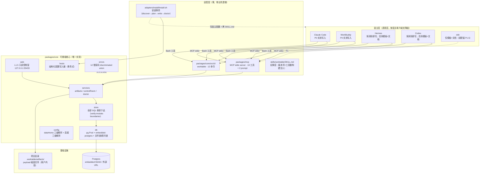
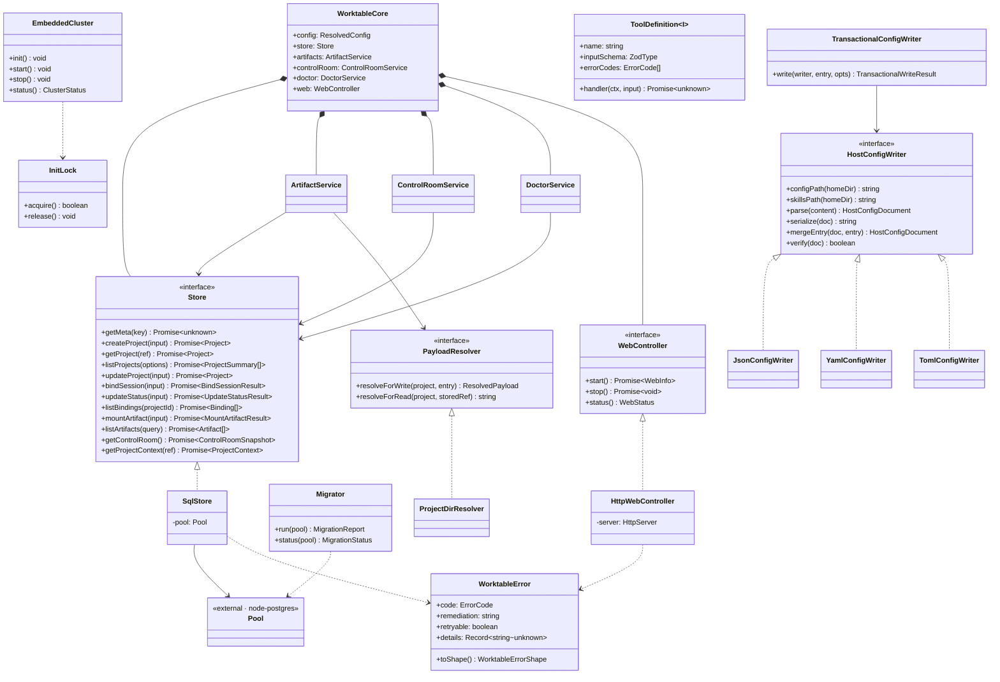
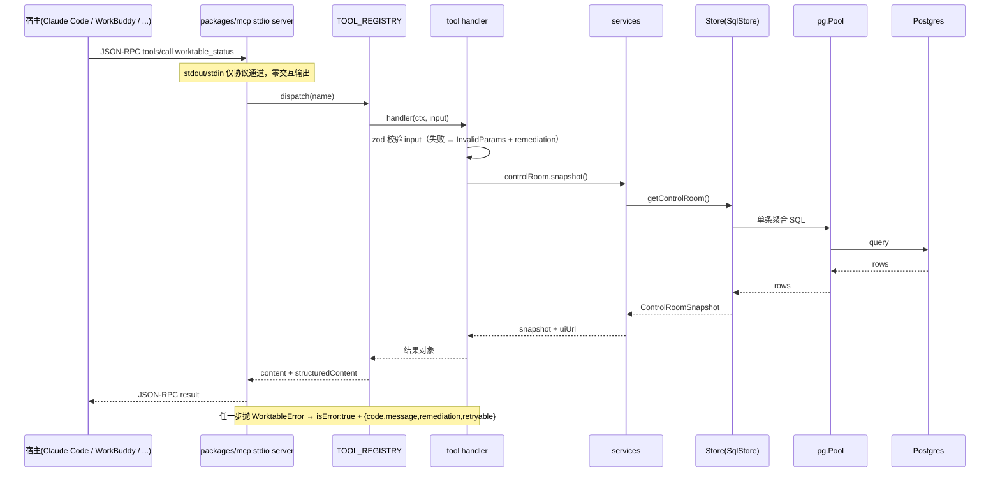
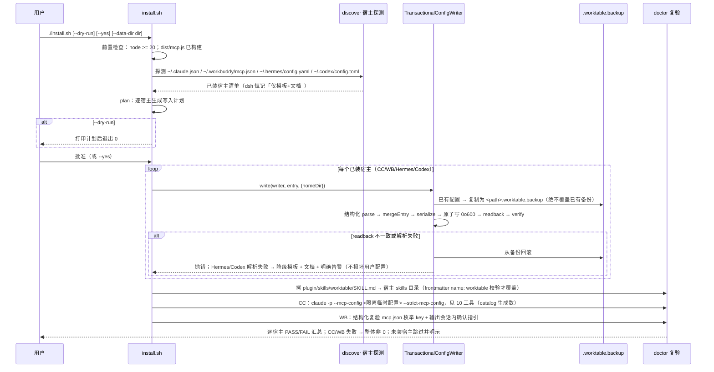
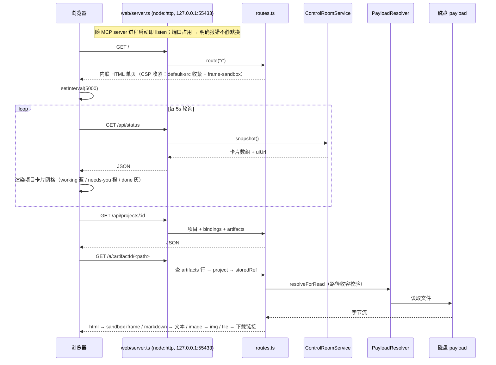

# Agent-WorkTable P0 架构设计（ARCHITECTURE）

> 版本：v1.0 · 2026-10-18 · 作者：高见远（架构师）
> 上游依据：《worktable 跨宿主插件开发方案》（2026-10-18 定稿，下称「定稿」）与《Agent-WorkTable P0 产品需求文档》（v1.0，下称「PRD」）。
> 本文只做架构设计与任务分解，不写实现代码；所有架构结论以定稿为准、产品层细节以 PRD 及主理人裁决（PRD §6）为准。凡两者不一致处，一律进入第 8 章「偏差与风险」如实记录，不静默择一。

---

## 1. 架构总览

### 1.1 一句话架构与数据流

**数据流一句话**：五宿主经「MCP stdio / CLI」两个薄适配层读写同一个可移植核心（`packages/core`），核心把全部 SQL 收敛在 Store 模块内、经 `pg.Pool` 打到同一份 Postgres（embedded 或外部），产物 payload 落项目目录 `.worktable/artifacts/`，L1.5 只读控制室（`127.0.0.1:55433`）作为全部宿主的保底可视化。

三个不可动的前提：

1. **Postgres 是唯一事实源**——运营状态（项目/绑定/产物清单）全部入库；不存浏览器缓存、不存宿主私有目录（PRD G1）。
2. **stdio 是协议通道**——MCP server 的 stdout/stdin 零交互输出，数据位置选择 UX 只走 install.sh / CLI `worktable init` / Agent 对话转述（定稿 §4.1）。
3. **SQL 不出 Store**——`verify:module-boundaries` 是架构红线，也是未来多后端（如回退 SQLite）只换一个实现的唯一前提（定稿 §4.5）。

### 1.2 分层图



### 1.3 P0 范围边界声明

**P0 做（垂直切片，PRD §3.1 十一条）**：

| 域 | 内容 |
|---|---|
| 核心 | 6 张表（meta/projects/bindings/panes/artifacts/events，events 仅预留建表、零业务写入）+ 手写编号迁移 + checksum 防篡改 |
| 数据库 | embedded 集群生命周期 + 连接三级解析 + `setup-required`/`db-unavailable` 显式失败 + 文件锁防五宿主竞争初始化 |
| MCP | stdio server，10 个工具 + 2 个 prompt，12 错误码投影（快照测试） |
| CLI | 12 命令（init/pg/migrate/doctor/new/ls/open/bind/status/mount/check/ui），`--json` 机器可读 |
| UI | L1.5 只读控制室单页（127.0.0.1:55433，5s 轮询，CSP 收紧，产物 sandbox iframe） |
| 纪律层 | SKILL.md 一份源文件，构建注入版本号与工具数，无 `@latest` |
| 安装 | install.sh 安装事务；CC+WB 实测写入；Hermes/Codex 探测到即写；dsh 仅模板+文档 |

**P0 不做（PRD §5 + §3.0，锁死防蔓延）**：`layout` 工具（P1）、`export`/`import`（P3）、`backup`/`relocate`（P1）、`uninstall.sh`（P1-3）、dsh/Hermes 注入适配（P1）、`serve` 常驻模式与 WS 推送（P2）、MCP Apps 面板（P2）、events 业务写入与查询（P1-8/P3）、UI 写入与登录鉴权、RLS/组织/SSO、npm 发布（走 GitHub Releases tgz + 目录直拷）。

### 1.4 实现级决策表（架构师负责决策的项）

| # | 决策 | 结论 | 一句话理由 |
|---|---|---|---|
| A1 | packages/core 内部模块划分 | errors / ids / config / db / migrations / store / services / protocol / hosts / web / cli 十一模块，按「依赖只准向下」分层（见 §7.2） | 每模块单一职责且可独立测试；SQL 只在 store，协议收容只在 protocol，宿主差异只在 hosts |
| A2 | L1.5 web 服务器方案 | **node:http 内置模块**，不用任何 web 框架 | 只有 4 个路由 + 1 个内联静态页，框架引入的依赖与抽象全是净成本；CSP/回环绑定/端口语义需要完全手工控制 |
| A3 | 测试框架与构建方式 | **vitest**（单测/集成/快照）+ **tsc --noEmit**（类型门禁）+ **esbuild**（双入口 bundle）；不用 jest | vitest 原生 TS/ESM、快照与并发模式开箱即用；esbuild 与 tsc 分离，构建快、类型检查独立成门禁 |
| A4 | 包管理器与 workspace 形态 | **npm workspaces**（root package.json 声明 `packages/*`），不引入 pnpm/yarn | 零额外环境假设，`npm ci` 即可复现；lockfile 提交 |
| A5 | 跨 package 共享约定 | 错误码 union 唯一定义在 `packages/core/src/errors/codes.ts`，经 core 公共出口（`src/index.ts`）导出，mcp/cli 一律 import 自 `@worktable/core`；类型共享走 core 构建产物 d.ts；版本号与工具数由构建脚本从「core package.json version + 工具注册表」注入 SKILL.md 与 plugin.json | 单一事实源防漂移；生成物禁手改（定稿 §9 版本钉死） |

补充决策（实现期需锁定，已在第 6 章标注范围）：迁移 SQL 采用「`migrations/*.sql` 手写源文件 → 构建时生成 `src/migrations/generated.ts`（内联 SQL + sha256）」双形态——源文件满足定稿「手写编号迁移」与 checksum 防篡改，生成物保证 esbuild bundle 自包含（定稿 §9「一个 bundle 自包含启动」）。

---

## 2. 文件清单

路径均为相对仓库根。`【生成】` = 构建产生、禁手改、提交或 gitignore 见表注；`【预留】` = 本期不建文件仅登记边界。

### 2.1 仓库根

| 文件 | 职责 |
|---|---|
| `package.json` | npm workspaces 根（`packages/*`）；声明 build 与全部 `verify:*` 脚本 |
| `package-lock.json` | 依赖锁定（生成物，必须提交，保 `npm ci` 可复现） |
| `tsconfig.base.json` | 共享 TS 配置（strict、ES2022、Node 模块解析） |
| `.gitignore` | 忽略 `node_modules/`、各 `dist/`、`src/migrations/generated.ts`、`plugin/` |
| `.github/workflows/verify.yml` | CI 门禁矩阵（见 §5.3 与 §7.6） |
| `README.md` | 项目说明、快速开始、embedded 首次需联网下载 PG 二进制的明示 |
| `scripts/build.mjs` | esbuild 双入口 bundle（`core/dist/cli.js` + `mcp/dist/mcp.js`）并组装 `plugin/` 产物目录 |
| `scripts/gen-migrations.mjs` | 读 `migrations/*.sql` → 生成 `packages/core/src/migrations/generated.ts`（内联 SQL + sha256） |
| `scripts/gen-catalog.mjs` | 读工具注册表 → 生成 `docs/tool-catalog.md`（工具数唯一生成源） |
| `scripts/gen-skill.mjs` | 读 `skills/worktable/SKILL.md` 源 → 注入 `{{VERSION}}`/`{{TOOL_COUNT}}` → 写 `plugin/skills/worktable/SKILL.md` |
| `scripts/verify-boundaries.mjs` | 模块边界守卫：SQL 字面量只准出现在 `src/store/` 与 `migrations/`；导入方向只准向下 |

### 2.2 packages/core（`@worktable/core`，含 CLI）

| 文件 | 职责 |
|---|---|
| `packages/core/package.json` | 依赖声明（pg / embedded-postgres / yaml / smol-toml）；`bin: { worktable: dist/cli.js }` |
| `packages/core/tsconfig.json` | core 编译配置（extends base，含 d.ts 产出） |
| `packages/core/src/index.ts` | 公共出口 barrel + `createWorktable()` 组合根（CLI/MCP/install 唯一装配点） |
| `packages/core/src/errors/codes.ts` | 12 错误码 discriminated union、`WorktableError` 类、remediation 表、node-postgres 错误码→业务错误码映射 |
| `packages/core/src/errors/index.ts` | errors barrel |
| `packages/core/src/ids.ts` | `prj_`/`bnd_`/`art_` ID 生成（sha256 内容寻址，定稿 §4.3） |
| `packages/core/src/config/types.ts` | `ResolvedConfig` / `DataHome` / 数据库连接描述类型 |
| `packages/core/src/config/dataHome.ts` | dataHome 三级解析链（env > `~/.config/worktable/config.json` > `~/.worktable/`）+ 选择记录读写 |
| `packages/core/src/config/database.ts` | 数据库连接三级解析链（env > `<dataHome>/config.yaml` > embedded 默认）+ `config.yaml` 读写 |
| `packages/core/src/config/yaml.ts` | config.yaml 最小读写（基于 `yaml` 包，0600 权限） |
| `packages/core/src/config/index.ts` | config barrel |
| `packages/core/src/db/pool.ts` | `pg.Pool` 封装（max 5、`statement_timeout=5s`、`idle_in_transaction_session_timeout=30s`、utf8） |
| `packages/core/src/db/embedded.ts` | embedded-postgres 集群生命周期（initialise/start/stop/status，unix socket 优先回落 127.0.0.1:55432） |
| `packages/core/src/db/lock.ts` | 文件锁（`<dataHome>/pgdata/.worktable-init.lock`，mkdir 独占 + pid 存活 stale 检测）+ `pg_advisory_lock(hashtext('worktable:admin'))` |
| `packages/core/src/db/index.ts` | db barrel + `getPool(config)`（懒连接；embedded 模式按需拉起集群） |
| `packages/core/migrations/001_init.sql` | 6 表 + 部分唯一索引 + 复合主键 DDL（与定稿 §4.2 全同） |
| `packages/core/src/migrations/runner.ts` | 迁移应用/状态/checksum 校验（checksum 不符 → `schema-mismatch` 明确报错不静默续跑） |
| `packages/core/src/migrations/generated.ts` | 【生成】内联迁移 SQL + sha256（gitignore） |
| `packages/core/src/migrations/index.ts` | migrations barrel |
| `packages/core/src/store/types.ts` | 6 表 Row 类型 + 全部输入/输出 DTO（§3.1） |
| `packages/core/src/store/meta.ts` | meta 表读写（schema_version / data_home / instance_id） |
| `packages/core/src/store/projects.ts` | 项目 CRUD（create/get/list/update，name 唯一冲突映射） |
| `packages/core/src/store/bindings.ts` | 绑定与状态机（部分唯一索引冲突映射、force 顶替、revision 乐观并发） |
| `packages/core/src/store/artifacts.ts` | 产物列表查询 |
| `packages/core/src/store/mount.ts` | mount 单事务：UPSERT `panes(pane_id, binding_id)` + INSERT `artifacts` |
| `packages/core/src/store/status.ts` | 控制室单条聚合查询（卡片字段 + preview 链接） |
| `packages/core/src/store/index.ts` | `Store` 接口 + `createStore(pool)` |
| `packages/core/src/services/artifacts.ts` | ArtifactService：路径收容 + payload 存在校验 + store 事务编排 |
| `packages/core/src/services/controlRoom.ts` | ControlRoomService：status 快照 + `uiUrl` 拼装 |
| `packages/core/src/services/doctor.ts` | DoctorService：`check` 报告（schema 版本/连通/孤儿绑定/目录可写/issues） |
| `packages/core/src/services/index.ts` | services barrel |
| `packages/core/src/protocol/payload.ts` | `PayloadResolver` 接口 + P0 唯一实现 `ProjectDirResolver` + 路径收容算法（拒绝对绝对路径/`../`/symlink 逃逸） |
| `packages/core/src/hosts/types.ts` | `HostId`、`HostConfigWriter`、`McpServerEntry` 类型 |
| `packages/core/src/hosts/registry.ts` | 五宿主注册表（配置文件路径/格式/skills 目录/P0 动作） |
| `packages/core/src/hosts/writers.ts` | Json/Yaml/Toml 三个结构化写入器 + `TransactionalConfigWriter`（备份→原子写→readback→回滚） |
| `packages/core/src/hosts/index.ts` | hosts barrel |
| `packages/core/src/web/server.ts` | node:http 服务器（仅绑 127.0.0.1；端口 env > config.yaml > 55433；占用明确报错不静默换） |
| `packages/core/src/web/routes.ts` | 4 路由（`/`、`/api/status`、`/api/projects/:id`、`/a/:artifactId/*`）+ CSP + payload 静态分发 |
| `packages/core/src/web/page.ts` | 控制室单页（内联 HTML/CSS/JS 模板字符串，5s 轮询，三态徽标，产物查看器） |
| `packages/core/src/web/index.ts` | web barrel + `startWebServer(deps)` |
| `packages/core/src/cli/main.ts` | argv 解析 + 子命令路由 + 退出码（0/1/2） |
| `packages/core/src/cli/commands.ts` | 12 命令实现（全部薄封装 core 组合根，零业务逻辑） |
| `packages/core/src/cli/render.ts` | 人类可读渲染（简体中文、Markdown 表格） |
| `packages/core/src/cli/index.ts` | cli barrel |
| `packages/core/tests/migrations.integration.test.ts` | 迁移集成：空库建 6 表、幂等、checksum 篡改报错（P0-1） |
| `packages/core/tests/datahome.test.ts` | 连接解析链优先级、`setup-required` 不静默默认（P0-2） |
| `packages/core/tests/concurrency.test.ts` | 多进程并发 bind 一成一败、死锁重试、顾问锁互斥（P0-10） |
| `packages/core/tests/embedded.lifecycle.test.ts` | init/start/stop/status、端口占用处理（P0-2） |
| `packages/core/src/**/*.test.ts` | 同目录单元测试（errors/ids/config/store/protocol/hosts/web/cli，命名约定见 §7.5） |

### 2.3 packages/mcp（`@worktable/mcp`）

| 文件 | 职责 |
|---|---|
| `packages/mcp/package.json` | 依赖 `@worktable/core`（workspace）+ `@modelcontextprotocol/sdk` + `zod` |
| `packages/mcp/tsconfig.json` | mcp 编译配置 |
| `packages/mcp/src/index.ts` | stdio server 入口（宿主以 `node dist/mcp.js` 启动；stdout 零交互输出） |
| `packages/mcp/src/server.ts` | McpServer 装配：注册 10 工具 + 2 prompt + 传输层 |
| `packages/mcp/src/registry.ts` | `TOOL_REGISTRY` + `PROMPT_REGISTRY`（catalog 与 SKILL.md 工具数的唯一数据源） |
| `packages/mcp/src/errors.ts` | 错误投影：`WorktableError` → MCP `isError` 结果（结构化 `{code,message,remediation,retryable,details}`）；zod 校验失败 → 协议级 InvalidParams + remediation |
| `packages/mcp/src/prompts.ts` | `control-room` / `window-task` 静态模板（主理人裁决 4 锁 P0） |
| `packages/mcp/src/tools/projects.ts` | list / open / create / update 4 工具 |
| `packages/mcp/src/tools/bindings.ts` | bind_session / update_status 2 工具 |
| `packages/mcp/src/tools/artifacts.ts` | mount_artifact / list_artifacts 2 工具 |
| `packages/mcp/src/tools/status.ts` | status 工具（零模型调用纯本地聚合 + uiUrl） |
| `packages/mcp/src/tools/check.ts` | check 工具 |
| `packages/mcp/tests/contract.test.ts` | MCP 契约快照：10 工具 × 声明的错误码子集 + 2 prompt + catalog 一致性（P0-3） |
| `packages/mcp/tests/__snapshots__/contract.snap` | 【生成】契约快照 |

### 2.4 skills / adapters / deploy / docs / plugin

| 文件 | 职责 |
|---|---|
| `skills/worktable/SKILL.md` | 纪律层源文件：frontmatter `name: worktable`、五段式工作流、硬性纪律；含 `{{VERSION}}`/`{{TOOL_COUNT}}` 占位符（P0-6） |
| `adapters/install/install.sh` | 安装事务：discover→plan(--dry-run)→write(备份/原子/readback)→doctor 复验（P0-7） |
| `adapters/install/templates/dsh/cordis.patch.yml` | dsh 配置模板（仅模板+文档，适配实现留 P1-5） |
| `adapters/install/templates/hermes/config.snippet.yaml` | Hermes 未探测到时的交付模板 |
| `adapters/install/templates/codex/config.snippet.toml` | Codex 老版本（<0.147.0）手工路径模板 |
| `deploy/.gitkeep` | 【预留】P2 serve 常驻单元（launchd/systemd）与 P3 Compose 的目录占位，本期不建文件 |
| `docs/PRD.md` | 产品需求文档（本次一并提交） |
| `docs/ARCHITECTURE.md` | 本文档 |
| `docs/tool-catalog.md` | 【生成】工具 catalog（名称/参数/错误码），`verify:catalog` 门禁 diff 检查 |
| `docs/E2E-CHECKLIST.md` | P0-11 人工验收清单（干净机全链路 + CC/WB 实测握手记录表） |
| `plugin/plugin.json` | 【生成】Agent Plugins v1.0.0 manifest（version 随 core package.json） |
| `plugin/mcp.json` | 【生成】`mcpServers` 声明，`command: node` + `args: ["${PLUGIN_ROOT}/dist/mcp.js"]`，无凭证 |
| `plugin/skills/worktable/SKILL.md` | 【生成】注入版本号与工具数后的纪律层（install.sh 拷贝源） |
| `plugin/dist/mcp.js` | 【生成】bundle 拷贝（Codex 原生加载路径） |

### 2.5 本期明确不建（防范围蔓延，登记边界）

| 不建 | 去向 | 说明 |
|---|---|---|
| `packages/skill/` 独立包 | — | 定稿附录 A 的独立 skill 包；本期 SKILL.md 源直接放 `skills/worktable/`（PRD 附目录口径） |
| `adapters/dsh/`、`adapters/hermes-dashboard/` | P1-5 / P1-6 | 注入级适配 |
| `src/store/events.ts` 及 events 业务写入 | P1-8 / P3 | events 表随 `001_init` 预留建表（主理人裁决 3），P0 零业务写入；`open_project` 的 `recentEvents` 恒返回空数组 |
| `uninstall.sh` | P1-3 | 逆序回滚 |
| web UI 写入路由 | P2-4 | P0 只读 |
| `ui://worktable/control-room` MCP Apps 资源 | P2-2 | 宿主未确认支持时不启用，`host-unsupported` 明示 |
| `worktable backup/relocate/export/import` | P1 / P3 | CLI 与工具均不实现 |

---

## 3. 数据结构与接口

### 3.1 六张表的 TS 类型与 DTO

Row 类型（`src/store/types.ts`，与定稿 §4.2 DDL 一一对应；时间列 DB 存 UTC `TIMESTAMPTZ`，Node 侧为 `Date`）：

```ts
// ---- 枚举 ----
export type BindingStatus = 'working' | 'needs-you' | 'done';
export type ArtifactType = 'html' | 'markdown' | 'image' | 'file';
export type ArtifactStatus = 'pending' | 'mounted' | 'locked';
export type HostId = 'dsh' | 'hermes' | 'workbuddy' | 'claude-code' | 'codex';

// ---- Row（6 表）----
export interface MetaRow      { key: string; value: unknown }                    // JSONB
export interface ProjectRow { // projects
  project_id: string; name: string; icon: string | null; folder: string;
  position: number; hidden: boolean; created_at: Date; created_by: string;
}
export interface BindingRow { // bindings
  binding_id: string; project_id: string; host: HostId; session_id: string;
  cwd: string; status: BindingStatus; note: string | null;
  revision: number; updated_at: Date;
}
export interface PaneRow    { pane_id: string; binding_id: string; layout: unknown; updated_at: Date } // layout JSONB，P1 用
export interface ArtifactRow { // artifacts
  artifact_id: string; project_id: string; pane_id: string; binding_id: string;
  title: string; type: ArtifactType; payload_path: string; status: ArtifactStatus;
  meta: Record<string, unknown>; created_at: Date;
}
export interface EventRow   { // events（P0 仅预留建表，零业务写入）
  event_id: string; ts: Date; actor: string; project_id: string | null;
  kind: string; payload: Record<string, unknown>;
}
```

对外 DTO（MCP/CLI/web 共用，`unknown` 即 JSONB）：

```ts
export interface Project extends ProjectRow {}
export interface Binding extends BindingRow {}
export interface Artifact extends ArtifactRow {}

export type ProjectRef = { projectId: string } | { name: string };

export interface ProjectSummary {           // list_projects 每项
  projectId: string; name: string; icon: string | null;
  position: number; hidden: boolean;
  status: BindingStatus | null;             // active binding 三态；无绑定为 null
  host: HostId | null; cwd: string | null;
  pendingArtifacts: number;
  lastActivityAt: Date | null;
}

export interface ControlRoomCard {          // PRD §4.1 备注 3 字段表
  projectId: string; name: string; icon: string | null;
  status: BindingStatus | null;
  host: HostId | null; cwd: string | null;
  lastEvent: string | null;                 // 如 "mounted art_7f3a…"
  pendingArtifacts: number;
  preview: string | null;                   // 最近挂载产物的 L1.5 查看链接
  updatedAt: Date | null;
}
export interface ControlRoomSnapshot { uiUrl: string; generatedAt: string; projects: ControlRoomCard[] }

export interface ProjectContext {           // open_project 返回体
  project: Project;
  bindings: Binding[];
  artifacts: Artifact[];
  recentEvents: EventRow[];                 // P0 恒为空数组（P1-8 启用）
}

export interface CheckReport {              // worktable_check 返回体
  schemaVersion: string | null;
  dbReachable: boolean;
  orphanBindings: Array<{ bindingId: string; projectId: string; reason: string }>;
  projectDirsWritable: Array<{ projectId: string; folder: string; writable: boolean }>;
  issues: Array<{ code: ErrorCode | 'warn'; message: string }>;
}
```

### 3.2 Store 接口（方法级签名）

`Store` 是核心唯一持 SQL 的接口（`src/store/index.ts`），实现 `SqlStore` 只依赖 `pg.Pool` 与 `errors`，不感知 MCP/CLI/web：

```ts
export interface Store {
  // ---- meta ----
  getMeta<T = unknown>(key: string): Promise<T | null>;
  setMeta(key: string, value: unknown): Promise<void>;

  // ---- projects ----
  createProject(input: CreateProjectInput): Promise<Project>;
  getProject(ref: ProjectRef): Promise<Project | null>;
  listProjects(options?: ListProjectsOptions): Promise<ProjectSummary[]>;
  updateProject(input: UpdateProjectInput): Promise<Project>;   // delete 需 confirm:true，级联由 FK 完成，不动文件夹

  // ---- bindings / 状态机 ----
  bindSession(input: BindSessionInput): Promise<BindSessionResult>;
  updateStatus(input: UpdateStatusInput): Promise<UpdateStatusResult>;
  listBindings(projectId: string): Promise<Binding[]>;

  // ---- artifacts ----
  mountArtifact(input: MountArtifactInput): Promise<MountArtifactResult>;   // 单事务 UPSERT panes + INSERT artifacts
  listArtifacts(query: ListArtifactsQuery): Promise<Artifact[]>;

  // ---- 聚合 ----
  getControlRoom(): Promise<ControlRoomSnapshot>;              // 单条聚合查询
  getProjectContext(ref: ProjectRef): Promise<ProjectContext | null>;
}

export interface CreateProjectInput {
  name: string; folder: string; icon?: string | null;
  createdBy: string;                    // 'host:claude-code' 等，团队模式即审计列
  position?: number;                    // 缺省 max(position)+1
}
export interface UpdateProjectInput {
  projectId: string;
  name?: string; icon?: string | null; position?: number; hidden?: boolean;
  delete?: boolean; confirm?: boolean;  // delete=true 时 confirm 必须为 true（zod refine 拦截）
}
export interface BindSessionInput {
  projectId: string; host: HostId; sessionId: string; cwd: string; force?: boolean;
}
export interface BindSessionResult { bindingId: string; revision: number }   // revision 恒为 1
export interface UpdateStatusInput {
  projectId: string; status: BindingStatus; note?: string | null; expectedRevision?: number;
}
export interface UpdateStatusResult { revision: number }
export interface MountArtifactInput {   // entry 已由 PayloadResolver 收容校验；payloadPath 为入库存储引用
  projectId: string; paneId: string; bindingId: string;
  title: string; type: ArtifactType; entry: string; payloadPath: string;
  meta?: Record<string, unknown>;
}
export interface MountArtifactResult { artifactId: string; mountUri: string }
// mountUri = worktable://<paneId>-<bindingId>/<artifactId>
export interface ListProjectsOptions { includeHidden?: boolean }
export interface ListArtifactsQuery { projectId: string; status?: ArtifactStatus }
```

错误映射约定（`errors/codes.ts` 内集中定义，store 内不手写文字）：`projects.name` 唯一冲突（23505 + 约束名 `projects_name_key`）→ `duplicate-project`；部分唯一索引 `idx_bindings_active` 冲突 → `binding-conflict`；死锁 40P01 / 序列化失败 40001 重试一次仍败 → `db-conflict`；`statement_timeout` 取消（57014）→ `db-timeout`；连接类错误（ECONNREFUSED/ENOENT socket/认证失败）→ `db-unavailable`。

### 3.3 服务层与组合根

Store 只做 SQL；跨模块编排在 services；装配点在 `createWorktable`（`src/index.ts`），CLI 与 MCP 共用同一组合根保行为一致（PRD P0-4 ③）：

```ts
export interface ResolvedConfig {
  dataHome: string;                                    // 绝对路径
  dataHomeSource: 'env' | 'config-json' | 'default';
  database: {
    mode: 'embedded' | 'external';
    url: string;
    source: 'env' | 'config-yaml' | 'embedded-default';
  };
  webPort: number;                                     // env > config.yaml > 55433
  initialized: boolean;                                // <dataHome>/config.yaml 是否存在
}

export interface WorktableCore {
  config: ResolvedConfig;
  store: Store;
  artifacts: ArtifactService;
  controlRoom: ControlRoomService;
  doctor: DoctorService;
  web: WebController;
}

export interface ArtifactService {
  mount(input: MountArtifactInput): Promise<MountArtifactResult>;  // resolver 收容 + 存在校验 + store 事务
}
export interface ControlRoomService {
  snapshot(): Promise<ControlRoomSnapshot>;                          // store.getControlRoom + uiUrl
}
export interface DoctorService {
  check(): Promise<CheckReport>;                                     // store + resolver 可写性 + meta 版本
}
export interface WebController {
  start(): Promise<{ port: number; url: string }>;                   // 端口占用 → 明确报错不静默换
  stop(): Promise<void>;
  status(): { running: boolean; port: number; url: string };
}

export function createWorktable(): Promise<WorktableCore>;   // 懒连接：DB 不可用不抛，错误延迟到首次方法调用
```

懒连接与 `setup-required` 语义（对定稿 §4.1 的落地解释，见 §8.1 D-11）：完全无配置（无 env、无 `<dataHome>/config.yaml`）时 `createWorktable()` 正常返回，任何 store 方法首次调用抛 `setup-required` + 候选清单（embedded 本地库 / 外部 URL），**不静默起 embedded**；`config.yaml` 声明 `mode: embedded` 时，URL 缺省为 unix socket / `127.0.0.1:55432`，且首次使用时按文件锁拉起集群，失败抛 `db-unavailable`。schema 版本校验在组合根内做一次并 memoize，不符则每次调用抛 `schema-mismatch`。

### 3.4 MCP 工具注册表与 prompts

```ts
export interface ToolContext { core: WorktableCore }
export interface ToolDefinition<I> {
  name: string;                  // 'worktable_list_projects'（宿主加前缀 mcp__worktable__*）
  title: string;
  description: string;
  inputSchema: ZodType<I>;       // zod；校验失败 → 协议级 InvalidParams + remediation
  errorCodes: readonly ErrorCode[];   // 声明的投影错误码（catalog 与快照的数据源）
  handler: (ctx: ToolContext, input: I) => Promise<unknown>;
}
export interface PromptDefinition { name: string; title: string; description: string; messages: PromptMessage[] }
export const TOOL_REGISTRY: readonly ToolDefinition<unknown>[];    // P0 = 10 个
export const PROMPT_REGISTRY: readonly PromptDefinition[];         // P0 = 2 个
```

P0 十个工具与声明错误码（全集 12 码的投影子集；`invalid params` 为协议级参数校验，不占 12 码）：

| 工具 | 实现文件 | 声明的错误码 |
|---|---|---|
| `worktable_list_projects` | tools/projects.ts | setup-required, db-unavailable, schema-mismatch |
| `worktable_open_project` | tools/projects.ts | project-not-found, setup-required, db-unavailable |
| `worktable_create_project` | tools/projects.ts | duplicate-project, setup-required, db-unavailable（+ folder 不存在 → invalid params + remediation） |
| `worktable_update_project` | tools/projects.ts | project-not-found, duplicate-project, setup-required, db-unavailable（+ delete 缺 confirm → invalid params） |
| `worktable_bind_session` | tools/bindings.ts | binding-conflict, project-not-found, db-conflict, setup-required, db-unavailable |
| `worktable_status` | tools/status.ts | setup-required, db-unavailable |
| `worktable_update_status` | tools/status.ts | revision-conflict, project-not-found, setup-required, db-unavailable |
| `worktable_mount_artifact` | tools/artifacts.ts | path-escape, project-not-found, db-conflict, setup-required, db-unavailable（+ payload 不存在 → invalid params + 「先落盘再挂载」） |
| `worktable_list_artifacts` | tools/artifacts.ts | project-not-found, setup-required, db-unavailable |
| `worktable_check` | tools/check.ts | db-unavailable, setup-required |

prompts：`control-room`（把 status 渲染为当前宿主可用形态——CLI 宿主输出 Markdown 表格）、`window-task`（标准窗口任务流：open_project → 干活 → mount_artifact → update_status）。静态模板，不注入版本号（假设 A-4）；`verify:mcp` 增加漂移检查：prompt 文本中出现的 `worktable_*` 名称必须存在于注册表。

### 3.5 宿主配置写入器接口

```ts
export type HostConfigFormat = 'json' | 'yaml' | 'toml';
export interface McpServerEntry { command: string; args: string[]; env?: Record<string, string> }

export interface HostConfigWriter {
  readonly hostId: HostId;
  readonly format: HostConfigFormat;
  configPath(homeDir: string): string;      // 宿主配置文件绝对路径
  skillsPath(homeDir: string): string;      // 宿主 skills 目录
  parse(content: string): HostConfigDocument;             // 失败抛 ConfigParseError（→ 降级模板+告警）
  serialize(doc: HostConfigDocument): string;
  mergeEntry(doc: HostConfigDocument, entry: McpServerEntry): HostConfigDocument;  // 纯函数
  verify(doc: HostConfigDocument): boolean;               // 解析后枚举 key 复验（禁 grep 验嵌套配置）
}

export interface TransactionalWriteResult {
  path: string; backupPath: string | null; verified: boolean; rolledBack: boolean;
}
export class TransactionalConfigWriter {
  write(writer: HostConfigWriter, entry: McpServerEntry, opts: { homeDir: string }): Promise<TransactionalWriteResult>;
}
```

`write` 时序（定稿 §10）：已有配置 → 复制为 `<path>.worktable.backup`（**已有备份绝不覆盖**，COPYFILE_EXCL 语义）→ `parse` + `mergeEntry` + `serialize` → 原子写 0o600（tmp + rename）→ readback 重读 + `parse` + `verify` → 不一致立即从备份回滚并抛错。五宿主注册表（`hosts/registry.ts`）：

| host | 配置文件（格式） | skills 目录 | P0 动作 |
|---|---|---|---|
| claude-code | `~/.claude.json` 顶层 `mcpServers`（json） | `~/.claude/skills/` | 实测写入 + `claude -p --mcp-config` 隔离握手 |
| workbuddy | `~/.workbuddy/mcp.json` `mcpServers`（json） | `~/.workbuddy/skills/` | 实测写入 + 结构化复验 + 会话内人工确认 |
| hermes | `~/.hermes/config.yaml` `mcp_servers`（yaml） | `~/.hermes/skills/` | 探测到即写；解析失败 → 模板 + 文档 + 明确告警 |
| codex | `~/.codex/config.toml` `[mcp_servers.worktable]`（toml） | `~/.agents/skills/` | 探测到即写；同上护栏；老版本走模板 |
| dsh | `cordis.patch.yml` + tgz | — | 仅模板 + 文档（P1-5） |

### 3.6 Payload resolver 接口与路径收容算法

```ts
export interface ResolvedPayload { absolutePath: string; storedRef: string }
export interface PayloadResolver {
  resolveForWrite(project: Project, entry: string): ResolvedPayload;   // 抛 path-escape / payload-missing
  resolveForRead(project: Project, storedRef: string): string;         // 返回绝对路径；越界抛 path-escape
}
// P0 唯一实现 ProjectDirResolver：base = <project.folder>/.worktable/artifacts/，storedRef = entry（项目内相对路径）
// P1-4 预留 ReadOnlyFallbackResolver：base = <dataHome>/artifacts/<projectId>/，storedRef 以 'dataHome:' 前缀区分
//         —— resolver 是接口，P1-4 是新增分支而非改主干（主理人裁决 5）
```

收容算法（`protocol/payload.ts`，五步，任一步失败即抛且**库中零写入**）：① `entry` 必须为非空相对路径，拒绝绝对路径、拒绝任一 `..` 段（先按 POSIX 分隔符规范化）；② `candidate = path.resolve(project.folder, entry)`；③ 对 `candidate` 与其父链做 `fs.realpath`，与 `realpath(project.folder)` 比较，拒 symlink 逃逸；④ `fs.statSync` 必须为普通文件且 `fs.accessSync(R_OK)`；⑤ 通过后返回 `{ absolutePath, storedRef }`。`resolveForRead` 对 `/a/:artifactId/*` 静态路由执行同一算法（PRD P0-5 ⑥「payload 静态路由同样过路径收容校验」）。

### 3.7 错误码 union 与 WorktableError

```ts
export type ErrorCode =
  | 'setup-required' | 'db-unavailable' | 'db-timeout' | 'db-conflict'
  | 'project-not-found' | 'duplicate-project' | 'binding-conflict'
  | 'revision-conflict' | 'path-escape' | 'schema-mismatch'
  | 'host-unsupported' | 'resource-constraint';

export interface WorktableErrorShape {
  code: ErrorCode;
  message: string;                        // 简体中文，人类可读
  remediation: string;                    // 恢复建议（PRD §4.2 口径）
  retryable: boolean;
  details?: Record<string, unknown>;      // 如 setup-required 的候选清单
}

export class WorktableError extends Error {
  constructor(public readonly code: ErrorCode, message: string,
              public readonly remediation: string, public readonly retryable: boolean,
              public readonly details?: Record<string, unknown>);
  toShape(): WorktableErrorShape;
}
```

12 码的 `retryable` 与 `remediation` 以 PRD §4.2 表为唯一数据源，收敛在 `errors/codes.ts` 的 `ERROR_CATALOG` 常量（remediation 模板可带插值）。转换点只有两处（见 §7.4）：MCP 层 `packages/mcp/src/errors.ts`、CLI 层 `packages/core/src/cli/main.ts`。

### 3.8 类图



---

## 4. 调用流程

### 4.1 MCP 工具调用主链路（stdio → core → store → PG）



### 4.2 `worktable init` 首次初始化流程

```mermaid
sequenceDiagram
    participant U as 用户终端
    participant C as cli/main.ts
    participant CFG as config 解析链
    participant LK as InitLock(文件锁)
    participant EMB as EmbeddedCluster
    participant MIG as Migrator
    participant DB as Postgres

    U->>C: worktable init [--home dir] [--database-url url] [--yes]
    C->>CFG: 解析 dataHome（env > ~/.config/worktable/config.json > ~/.worktable/）
    alt 已初始化（config.yaml 存在）
        C-->>U: 明确报告当前状态，退出 0（幂等）
    else 显式参数或交互选择
        C->>CFG: 写 ~/.config/worktable/config.json（原子写，含历史路径）
    end
    C->>LK: acquire(<dataHome>/pgdata/.worktable-init.lock)
    alt embedded 模式（config.yaml mode: embedded）
        C->>EMB: initialise + start（unix socket 优先，回落 127.0.0.1:55432）
        EMB->>DB: initdb + 启动集群
    else 外部 URL 模式
        C->>DB: 连接测试（WORKTABLE_DATABASE_URL / config.yaml database.url）
    end
    C->>MIG: runMigrations(pool)（顾问锁 + 事务内应用）
    MIG->>DB: CREATE TABLE IF NOT EXISTS schema_migrations; 应用 001_init
    MIG->>MIG: sha256(SQL) 落 schema_migrations；meta.schema_version 更新
    C->>CFG: 写 <dataHome>/config.yaml（0600 原子写：database.mode/url、web.port）
    C->>LK: release
    C-->>U: doctor 首行：dataHome / 连接方式 / 运行模式 / schema 版本
```

### 4.3 install.sh 安装事务流程



### 4.4 `worktable_mount_artifact` 产物挂载事务

```mermaid
sequenceDiagram
    participant A as Agent(任意宿主)
    participant M as MCP worktable_mount_artifact
    participant AS as ArtifactService
    participant PR as PayloadResolver
    participant ST as Store
    participant DB as Postgres

    A->>M: {projectId, paneId, bindingId, title, type, entry}
    M->>M: zod 校验（缺参 → InvalidParams）
    M->>AS: mount(input)
    AS->>ST: getProject({projectId})
    alt 项目不存在
        ST-->>A: project-not-found（库中零写入）
    end
    AS->>PR: resolveForWrite(project, entry)
    PR->>PR: 五步收容：相对路径/拒 ../ /拒绝对路径/realpath 防 symlink 逃逸/文件存在可读
    alt 越界
        PR-->>A: path-escape（库中零写入）
    else payload 不存在或不可读
        PR-->>A: invalid params + remediation「先落盘再挂载」
    end
    AS->>ST: mountArtifact({...payloadPath: storedRef})
    ST->>DB: BEGIN; UPSERT panes(pane_id, binding_id); INSERT artifacts; COMMIT
    Note right of ST: panes 复合主键含 bindingId：晚到写入不覆盖新绑定
    alt 死锁 40P01 / 序列化 40001
        ST->>DB: 自动重试一次
        alt 仍冲突
            ST-->>A: db-conflict + 重试指引
        end
    end
    DB-->>ST: artifact_id
    ST-->>AS: {artifactId}
    AS-->>A: {artifactId, mountUri = worktable://paneId-bindingId/artifactId}
```

### 4.5 L1.5 页面渲染与 5s 轮询链路



---

## 5. 有序任务列表

### 5.1 任务总表（按依赖排序，共 5 个任务，全部 P0）

#### T01 项目基础设施与构建链

- **目标文件**：`package.json`、`package-lock.json`、`tsconfig.base.json`、`.gitignore`、`.github/workflows/verify.yml`（骨架）、`README.md`、`scripts/build.mjs`、`scripts/gen-migrations.mjs`、`scripts/gen-catalog.mjs`、`scripts/gen-skill.mjs`、`scripts/verify-boundaries.mjs`、`packages/core/package.json`、`packages/core/tsconfig.json`、`packages/core/src/index.ts`（占位 barrel）、`packages/mcp/package.json`、`packages/mcp/tsconfig.json`、`packages/mcp/src/index.ts`（占位入口）
- **验收要点**：`npm ci` 可安装；`npm run build` 能产出两个 bundle（占位内容空转退出即可）；`verify:typecheck` / `verify:module-boundaries` / `verify:catalog` 脚本可运行；CI 骨架触发 typecheck job
- **依赖项**：无
- **优先级**：P0

#### T02 数据层：错误契约 + 配置解析 + 数据库 + 迁移 + Store

- **目标文件**：`packages/core/src/errors/codes.ts`、`src/errors/index.ts`、`src/ids.ts`、`src/config/{types,dataHome,database,yaml,index}.ts`、`src/db/{pool,embedded,lock,index}.ts`、`migrations/001_init.sql`、`src/migrations/{runner,index}.ts`（`generated.ts` 由 T01 脚本生成）、`src/store/{types,meta,projects,bindings,artifacts,mount,status,index}.ts`、`packages/core/tests/migrations.integration.test.ts`、`tests/datahome.test.ts`、`tests/concurrency.test.ts`、`tests/embedded.lifecycle.test.ts`、各模块同目录 `*.test.ts`
- **验收要点**（对应 PRD P0-1 / P0-2 / P0-9 库层 / P0-10 库层）：① 空库 `worktable migrate` 建出 6 表，`schema_migrations` 记录 version+checksum，重复执行幂等；② 手改迁移文件后 checksum 不符 → `schema-mismatch` 明确报错不静默续跑；③ 连接解析链 env > config.yaml > embedded 默认，未配置返回 `setup-required` + 候选清单（不静默默认）；连不上返回 `db-unavailable` + 恢复建议；④ 五宿主并发 init 文件锁单 success；⑤ bind 冲突走部分唯一索引（`binding-conflict`）、`force` 顶替旧 binding 置 done、`expectedRevision` 不符 `revision-conflict`；⑥ mount 单事务 + panes 复合主键晚到不覆盖；⑦ `verify:core` / `verify:concurrency` / `verify:embedded` / `verify:datahome` 绿
- **依赖项**：T01
- **优先级**：P0

#### T03 MCP 适配 + 产物协议 + L1.5 web UI

- **目标文件**：`packages/core/src/protocol/payload.ts`、`src/services/{artifacts,controlRoom,doctor,index}.ts`、`src/web/{server,routes,page,index}.ts`、`src/index.ts`（补组合根 `createWorktable`）、`packages/mcp/src/{index,server,registry,errors,prompts}.ts`、`packages/mcp/src/tools/{projects,bindings,artifacts,status,check}.ts`、`packages/mcp/tests/contract.test.ts` 及快照、`packages/core/src/protocol/payload.test.ts`、`src/web/routes.test.ts`
- **验收要点**（对应 PRD P0-3 / P0-5 / P0-9 全链路 / P0-10 工具层）：① 隔离配置握手列出 10 工具 + 2 prompt（数自 catalog 生成物）；② 12 错误码投影有快照测试；③ stdio 零交互输出（测试断言 stdout 仅协议帧）；④ `update_project` 删除路径缺 confirm 拒绝、确认后级联清零且磁盘目录不动；⑤ `127.0.0.1:55433` 可开、卡片字段齐全（name/icon/三态/host/lastEvent/preview）、点卡见产物、html sandbox iframe、markdown/image/file 可查看、顶栏实例信息、5s 内自动刷新、仅绑回环 + CSP；端口占用明确报错不静默换；⑥ `entry` 含 `../`/绝对路径/symlink 逃逸 → `path-escape` 库中零写入；payload 不存在 → invalid params + 「先落盘再挂载」；⑦ `verify:mcp` 绿
- **依赖项**：T02
- **优先级**：P0

#### T04 宿主适配 + CLI + SKILL + install.sh

- **目标文件**：`packages/core/src/hosts/{types,registry,writers,index}.ts`、`src/cli/{main,commands,render,index}.ts`、`skills/worktable/SKILL.md`、`adapters/install/install.sh`、`adapters/install/templates/{dsh/cordis.patch.yml,hermes/config.snippet.yaml,codex/config.snippet.toml}`、`src/hosts/writers.test.ts`、`src/cli/commands.test.ts`
- **验收要点**（对应 PRD P0-4 / P0-6 / P0-7 / P0-8）：① CLI 12 命令全部可用、退出码正确（0/1/2），`doctor` 首行输出 dataHome/连接方式/运行模式/schema 版本，CLI 与 MCP 共用组合根行为一致；② SKILL.md 一份源文件、构建注入版本号与工具数、全文无 `@latest`、frontmatter `name: worktable`、五段式工作流；③ install.sh：discover 识别已装宿主、`--dry-run` 列出计划、写入前备份且绝不覆盖已有备份、原子写 + readback 不一致即回滚、doctor 复验、重复安装幂等；④ CC/WB 实测写入并握手见 10 工具；Hermes/Codex 探测到即写（结构化解析后枚举 key 复验，禁 grep），解析失败降级模板 + 文档 + 告警；dsh 仅模板 + 文档；⑤ `verify:install` / `verify:host:cc` / `verify:host:wb` / `verify:skill` 绿（宿主实测握手为本地门禁，CI 用 mock 宿主目录）
- **依赖项**：T02、T03（`worktable ui` 依赖 web 模块；install.sh doctor 依赖已构建的 mcp bundle）
- **优先级**：P0

#### T05 端到端垂直链路与门禁闭环

- **目标文件**：`tests/e2e/vertical-chain.test.ts`（干净 dataHome：init → 经 MCP SDK client over stdio 模拟宿主会话 list/new/bind/mount/status → `uiUrl` 抓取断言项目与产物 → `worktable check` 全绿）、`docs/tool-catalog.md`（生成物提交）、`docs/E2E-CHECKLIST.md`（CC/WB 实测握手人工记录表）、`.github/workflows/verify.yml`（补全门禁矩阵）、`README.md`（完善快速开始）
- **验收要点**（对应 PRD P0-11）：① 干净 macOS：install.sh → `worktable init` → 模拟宿主会话全链路 → 浏览器打开 `uiUrl` 见项目与产物 → `worktable check` 全绿；② 同一数据库换 WorkBuddy 宿主配置（同 dataHome）可见完全相同状态；③ 清除宿主配置重装后数据仍在（证明事实源在 Postgres）；④ 全部 P0 门禁绿；⑤ 文档与代码一并提交
- **依赖项**：T04
- **优先级**：P0

> 并行提示（工程师排期用）：T03 与 T04 的 `src/hosts/*` 可并行启动（互不依赖）；T04 内部 CLI 命令与 install.sh 可并行。除 T01 外各任务仅依赖其上游数据层/适配层，无横向耦合。

### 5.2 PRD 需求追溯矩阵

| PRD 需求 | 主任务 | 协作任务 |
|---|---|---|
| P0-1 core 状态层与迁移 | T02 | T01（gen-migrations 脚本）、T05（门禁） |
| P0-2 embedded 集群与连接解析 | T02 | T04（CLI pg/init/doctor）、T05 |
| P0-3 MCP server 与错误契约 | T03 | T01（gen-catalog）、T05（快照门禁） |
| P0-4 CLI 最小集 | T04 | T02（组合根）、T03（ui 命令） |
| P0-5 L1.5 控制室 web UI | T03 | T04（ui 命令）、T05（浏览器验收） |
| P0-6 SKILL.md 纪律层 | T04 | T01（gen-skill 脚本）、T05（verify:skill） |
| P0-7 install.sh 安装事务 | T04 | T03（mcp bundle 供握手）、T05（e2e） |
| P0-8 宿主配置写入 | T04 | T05（verify:host:*） |
| P0-9 产物挂载协议 | T03 | T02（mount 事务）、T05 |
| P0-10 绑定与状态机 | T02 | T03（MCP 工具）、T05（并发门禁） |
| P0-11 端到端垂直链路 | T05 | T01–T04 全部 |

### 5.3 周阶段划分（P0 总计约 3 周）

| 周 | 任务 | 里程碑 |
|---|---|---|
| 第 1 周（D1–D5） | T01（D1–D2）+ T02（D3–D5） | M1：空库 migrate 建 6 表 + checksum/幂等/防篡改；embedded 一键起库；连接解析链与 `setup-required` 行为测试绿 |
| 第 2 周（D6–D10） | T03（D6–D9）+ T04 启动：hosts 写入器先行（D10） | M2：MCP 10 工具 + 2 prompt 契约快照绿；mount 全链路 + path-escape；控制室可开、5s 刷新、产物可查看 |
| 第 3 周（D11–D15） | T04 完成（D11–D13：CLI 12 命令 + SKILL.md + install.sh）+ T05（D14–D15） | M3：P0-11 端到端全绿；全部 `verify:*` 绿；文档与代码提交，交付 |

---

## 6. 依赖包清单

### 6.1 runtime

| 包 | 版本范围 | 用途 |
|---|---|---|
| `pg` | `^8.11.0`（实现期锁定） | Postgres 客户端（`Pool`，max 5，全部 SQL 的出口） |
| `embedded-postgres` | `^17.5.0`（实现期锁定；内置 zonky PG 13–18 二进制，首次 init 需联网下载 ~35MB） | embedded 集群生命周期管理 |
| `@modelcontextprotocol/sdk` | `^1.0.0`（实现期锁定；注意与 zod 版本配对） | MCP stdio server（工具/prompt/传输） |
| `zod` | `^3.23.0`（若 SDK 要求 zod 4 则随 SDK 锁定） | 工具入参 schema 与参数校验 |
| `yaml` | `^2.4.0` | `config.yaml` 与 Hermes `config.yaml` 结构化读写 |
| `smol-toml` | `^1.3.0`（备选 `@iarna/toml@^2.0`，实现期二选一锁定） | Codex `config.toml` 结构化读写 |

### 6.2 dev

| 包 | 版本范围 | 用途 |
|---|---|---|
| `typescript` | `^5.5.0` | 类型检查门禁（`tsc --noEmit`） |
| `esbuild` | `^0.24.0` | 双入口 bundle（`core/dist/cli.js`、`mcp/dist/mcp.js`） |
| `vitest` | `^2.1.0` | 单元/集成/快照测试（单测、集成、并发、契约） |
| `@types/node` | `^22.x` | Node 类型（引擎要求 Node >= 20，CI 固定 22.x） |
| `@types/pg` | `^8.11.0` | pg 类型 |
| `fast-check` | `^4.0.0`（可选，P0 可后置） | 属性测试（`verify:properties`；P0 关键不变量先用手写测试覆盖） |

**锁定纪律**：上表「实现期锁定」项须在 T01 内一次性锁定并写入 `package-lock.json`；`embedded-postgres` 与 `@modelcontextprotocol/sdk` 的锁定版本要记录在 README（两者是唯二具有外部二进制/协议兼容性约束的依赖）。

---

## 7. 跨文件共享约定

### 7.1 命名约定

| 类 | 约定 | 例 |
|---|---|---|
| 源文件/目录 | kebab-case | `dataHome.ts`、`protocol/payload.ts` |
| 类/接口/类型 | PascalCase | `WorktableError`、`HostConfigWriter` |
| 函数/变量 | camelCase | `resolveForWrite` |
| 环境变量 | `WORKTABLE_` 前缀大写下划线 | `WORKTABLE_HOME`、`WORKTABLE_DATABASE_URL`、`WORKTABLE_WEB_PORT` |
| ID | `prj_`/`bnd_`/`art_`/`evt_` + sha256 前 16 hex；`paneId` 由调用方提供（1–64 字符 `[a-zA-Z0-9_-]`，假设 A-1） | `prj_9f2c…` |
| 端口 | embedded PG 55432 / web 55433；占用即明确报错，不静默换 | — |
| 时间 | DB `TIMESTAMPTZ`（UTC 存储）；API JSON 序列化 `toISOString()`（Z 后缀） | — |

### 7.2 导入方向（依赖只准向下，禁止反向）

```
L0 errors / ids / store/types        （无内部依赖）
L1 config / db / migrations / protocol / hosts   （可依赖 L0）
L2 store                             （可依赖 L0 + db 类型；禁依赖 L1 各模块与上层）
L3 services                          （可依赖 L0–L2）
L4 cli / web                         （可依赖 L0–L3）
外部包 packages/mcp                  （只准 import @worktable/core 公共出口）
adapters/install                     （只调 CLI 与文件操作，不 import 源码）
```

红线：`store/` 内禁止出现 `../cli`、`../web`、`../services`、`../hosts` 的 import；`packages/mcp` 禁止 import `@worktable/core/src/*` 深路径（只准 barrel）。由 `scripts/verify-boundaries.mjs` 静态检查（正则 + 简单 AST 扫描，P0 够用，不引入 eslint 全链）。

### 7.3 SQL 收敛纪律

- SQL 字面量只准出现在 `packages/core/src/store/*.ts` 与 `packages/core/migrations/*.sql`；`migrations/runner.ts` 只消费 `generated.ts` 的内联字符串，不写 SQL。
- 新查询先问「属于哪个 store 模块」；跨表事务（mount）放 `store/mount.ts`，禁止在 services 里拼 SQL。
- 参数化查询一律 `$1..$n`，禁止字符串拼接值。

### 7.4 错误抛出与转换点

- 一切失败抛 `WorktableError`（12 码之一 + 中文 message + remediation）；禁止裸 `throw new Error('...')` 出现在 core 公共服务路径（协议层参数校验除外，走 zod）。
- **转换点只有两处**：`packages/mcp/src/errors.ts`（→ MCP `isError` + `structuredContent.error`）与 `packages/core/src/cli/main.ts`（→ stderr `[code] message / remediation` + 退出码）。改错误呈现格式只改这两处。
- node-postgres 原生错误 → `WorktableError` 的映射集中在 `errors/codes.ts` 的映射表（§3.2），store 内不手写错误文字。
- CLI 退出码：`0` 成功；`1` 业务错误（已打印错误码与 remediation）；`2` 用法错误（参数缺失/无法解析）。

### 7.5 测试命名与目录约定

- 单元测试与源码同目录：`src/<module>/<file>.test.ts`；集成测试（需要真实 PG）放 `packages/core/tests/*.test.ts`；e2e 放根 `tests/e2e/`。
- 集成测试的 PG 来源：`WORKTABLE_TEST_DATABASE_URL` 存在则连外部库（CI 默认），否则本地起 embedded（`verify:embedded` 语义即被覆盖）。
- `describe` 命名空间 = 模块路径，如 `describe('store.bindings')`；快照只允许出现在 `packages/mcp/tests/__snapshots__/`。
- 每个任务的验收要点中列出的测试文件随任务交付，不允许「实现完再补测」。

### 7.6 生成物纪律与门禁映射

- 禁手改生成物：`src/migrations/generated.ts`、`docs/tool-catalog.md`、`plugin/`、`package-lock.json`。发现数字不对，改生成链（`scripts/gen-*.mjs`），不改产物。
- 门禁映射（P0 范围）：`verify:typecheck`（tsc）/ `verify:core`（store+migrations+protocol 单测集成）/ `verify:concurrency`（多进程）/ `verify:embedded`（集群生命周期）/ `verify:datahome`（解析链）/ `verify:module-boundaries`（SQL 与导入方向）/ `verify:mcp`（契约快照 + prompt 漂移）/ `verify:catalog`（生成物 diff）/ `verify:skill`（frontmatter + 无 `@latest` + 注入值正确）/ `verify:install`（写入器事务语义，mock fs）/ `verify:host:cc`、`verify:host:wb`（本地门禁：真实宿主握手；CI 以 mock 宿主目录替代）。
- CI 矩阵（`.github/workflows/verify.yml`）：ubuntu（postgres service 容器）跑 core/concurrency/datahome/module-boundaries/mcp/catalog/skill/install；ubuntu + macOS 冒烟 embedded；宿主实测握手不入 CI（见 §8.3 R-2/R-3）。

---

## 8. 偏差与风险

### 8.1 偏差清单（PRD 与定稿不一致处，如实记录，不静默择一）

| # | 不一致点 | 处理口径 |
|---|---|---|
| D-1 | 定稿 §13 P0 为四宿主（Hermes/WorkBuddy/CC/Codex）隔离握手均见 12 工具；PRD §3.0/§6-2 收窄为 **CC+WB 实测握手**、Hermes/Codex 探测到即写（best-effort）、dsh 仅模板+文档 | 按 PRD 主理人裁决落地；install.sh 硬失败条件仅 CC/WB；未装宿主跳过并明示，不因宿主缺失失败 |
| D-2 | 工具数口径：定稿 §5 表格 11 行中 `export`/`import` 一行计 2 个工具（合 12）；PRD §4.1 同构但该行写作一个编号 | P0 实现 10 个；所有文档/SKILL.md/doctor/install.sh 中的工具数一律由 catalog 生成物注入，禁硬编码 |
| D-3 | 定稿 §7.4 写「隔离握手见 **12** 个工具」 | P0 实为 10 个；握手断言从 `docs/tool-catalog.md` 读取期望值，不写死数字 |
| D-4 | PRD §4.1 备注 3 status 卡片字段表含 `preview`（最近挂载产物的 L1.5 查看链接），但同节返回体示例 JSON 无 `preview` | 按字段表实现（`preview = uiUrl + /a/:artifactId/<入口文件名>`）；示例视为节选。**请产品确认** |
| D-5 | PRD §4.4 说 L1.5「跟随 MCP server 进程」；PRD §4.3 又有 CLI `worktable ui` 主动拉起——两者并存时 CLI 进程需自行托管 web server | 架构填补：`worktable ui` 在前台进程内起 web server（打印 uiUrl、尝试系统浏览器、Ctrl-C 退出）；MCP 场景下 web 端口占用 → stderr 明确错误 + status 响应附 `webUnavailable` 原因，**不静默换端口、不拖垮 MCP 工具**；CLI 场景端口占用 → 明确报错退出。**请产品确认** |
| D-6 | PRD P0-7⑤ 要求 install.sh doctor 对 CC/WB 做隔离握手见 10 工具；CC 有 `claude -p --mcp-config` 可自动化，**WorkBuddy 为 GUI 应用、无等价 CLI**（截至本设计未发现） | 落地口径：install.sh 对 WB 做结构化配置复验（解析 `mcp.json` 枚举 key）+ 输出会话内确认指引；WB 实测握手由人工在会话内完成并记入 `docs/E2E-CHECKLIST.md`。「CC+WB 实测握手」作为发布前人工验收项保持有效，只是 install.sh 不能对 WB 全自动。**主理人裁决（2026-10-18）：批准此口径**——WB 无 CLI 自动握手是客观事实，结构化复验 + 会话内人工确认 + checklist 留痕即正式验收路径 |
| D-7 | PRD §4.1 示例 `generatedAt` 带 `+08:00` 偏移；DB 为 `TIMESTAMPTZ`（UTC 存储） | 架构口径：DB 存 UTC；API 序列化为 UTC ISO（`Z` 后缀）；示例时区仅作示意。**请产品确认无本地化要求** |
| D-8 | 定稿 §13 P0 CLI 清单含 `backup`；PRD §3.0 将 `backup`/`relocate` 移 P1 | 按 PRD：P0 CLI 12 命令不含 backup/relocate |
| D-9 | 定稿 §12/P3-4 要求 `plugin.json` 过官方 schema 校验 | P0 只生成 `plugin/` 分发形态，不做官方 schema 校验（P3-4） |
| D-10 | PRD §4.1 #4 `worktable_update_project` 主要错误码列 `revision-conflict`，但定稿 DDL `projects` 表**无 revision 列**（revision 仅存在于 bindings） | 实现按定稿 DDL，不擅自加列：P0 该码仅由 `update_status` 产生；`update_project` 的契约码为 `project-not-found`/`duplicate-project`（delete 缺 confirm 走 invalid params）。catalog 中按此标注。**请产品确认** |
| D-11 | 定稿 §4.1 连接解析链第三级「embedded 默认」与 PRD P0-2③「未初始化返回 `setup-required`，不静默默认」存在语义张力（若把 embedded 默认当作无配置 fallback，就会静默起库） | 架构裁决：解析链实现为 env > `config.yaml`（声明 `mode: embedded` 时 URL 缺省为 socket/55432）> **`setup-required`**；即「embedded 默认」仅作为 init 后 embedded 模式内的 URL 缺省，完全无配置时不静默起 embedded。**主理人裁决（2026-10-18）：批准**——这与 PRD §6 裁决 1/「No silent fallback」纪律一致；请产品知悉 |

### 8.2 架构假设与待确认（UNCLEAR）

| # | 假设 | 影响 |
|---|---|---|
| A-1 | `paneId` 由调用方提供的自由字符串（定稿附录 B 示例 `pane_01`），架构按 1–64 字符 `[a-zA-Z0-9_-]` 校验，超出走 invalid params | 若产品要求服务端生成 paneId，`mount_artifact` 入参与 `panes` 写入逻辑需小改 |
| A-2 | `<dataHome>/config.yaml` 最小 schema：`{ database: { mode: embedded\|external, url? }, web: { port }, home: { path, history[] } }`（定稿未给字段表） | 实现期如需扩充字段须经主理人 |
| A-3 | `worktable init --yes` 默认：dataHome=`~/.worktable`、embedded 模式、端口 55432/55433；已初始化时 init 幂等退出 0 | 与 PRD「非交互」口径自洽 |
| A-4 | 2 个 MCP prompt 为静态模板，不注入版本号（仅 SKILL.md 注入） | prompt 文本提及的工具名由 `verify:mcp` 漂移检查兜底 |
| A-5 | 内容寻址 ID 的落地解释：稳定实体（project）用纯内容寻址（排除 folder，定稿 §4.3）；事件型实体（binding/artifact）在哈希中加入时间成分，保证重复操作产生新 ID 而非覆盖 | 与定稿「bnd_/art_ + digest」表述兼容；若产品要求纯内容寻址需回退讨论 |
| A-6 | meta 表键：`schema_version` / `data_home` / `instance_id`（init 时生成 uuid） | `doctor`/`check` 的数据来源 |

### 8.3 P0 风险与缓解

| # | 风险 | 缓解 |
|---|---|---|
| R-1 | **embedded-postgres 在 CI 的可测性**：首次 init 需联网下载 ~35MB 平台二进制（zonky）；postgres 不能以 root 运行（GitHub Actions 默认非 root 可行，容器边缘场景不行） | CI job A（ubuntu + postgres service 容器）经 `WORKTABLE_TEST_DATABASE_URL` 跑 store/concurrency/datahome 门禁；job B（ubuntu + macOS）冒烟 embedded 生命周期；README 明示「首次 init 需外网」。两条代码路径（外部库/embedded）都必须有测试覆盖 |
| R-2 | Claude Code 隔离握手依赖真实 `claude` CLI，CI 环境没有 | `verify:host:cc` 设为本地门禁；CI 用 mock 宿主目录验证配置写入器的结构化语义（parse/merge/serialize/verify 往返） |
| R-3 | WorkBuddy 无 CLI 自动握手手段（见 D-6） | 结构化复验 + 会话内人工确认 checklist；发布前人工执行并留记录 |
| R-4 | 并发门禁需要真实多进程（五宿主 = 五进程各自 Pool max 5） | `tests/concurrency.test.ts` 用 `child_process.spawn` 起真实子进程打同一库；macOS 本地与 CI 外部库均可跑 |
| R-5 | 五宿主竞争初始化的文件锁若自研不当，可能误判 stale 锁或死等 | 锁文件内写 pid + 启动时间；stale 判定用 `process.kill(pid, 0)` 存活探测（Windows 抛错时按不存在处理）；等待有超时上限，超时明确报错不无限等 |
| R-6 | bundle 体积与 embedded 二进制分发：`dist/mcp.js` 含 core 全量（pg + MCP SDK + zod + web 页），预计 1–2MB；embedded 二进制运行时下载 | tgz 分发只含 JS bundle；二进制由 embedded-postgres 首次 init 时下载并缓存于 dataHome；文档明示 |
| R-7 | 五宿主配置 schema 漂移（定稿 §14） | 写入器一律结构化解析 + 枚举 key 复验（禁 grep）；解析失败降级模板 + 文档 + 明确告警，绝不静默损坏用户配置（主理人裁决 2 护栏） |
| R-8 | `plugin/mcp.json` 的 `${PLUGIN_ROOT}` 占位符依赖 Codex >= 0.147.0 原生展开 | install.sh 探测 Codex 版本二选一：新版本走原生加载，老版本写 `~/.codex/config.toml` 绝对路径 |
| R-9 | 范围蔓延（定稿 §14 第一死因） | P0 铁律：只有注册表/绑定/状态/挂载四件事 + L1.5 只读；终端/分栏/events 写入/UI 写入全部锁后期；每个任务的验收要点即边界 |
| R-10 | `worktable check` 的「孤儿绑定」在 FK `ON DELETE CASCADE` 下不会出现真孤儿 | 按 PRD 字段表落地为语义检查：active binding 的 `cwd` 目录已不存在、artifact `payload_path` 磁盘文件缺失、项目目录不可写——全部进 `issues[]` 并给修复建议 |

---

## 附：本设计与 PRD 11 条需求的对照速查

P0-1 → §3.1/§3.2/T02；P0-2 → §3.3/T02；P0-3 → §3.4/§3.7/T03；P0-4 → §5.1 T04；P0-5 → §1.4 A2/§4.5/T03；P0-6 → §1.4 A5/T04；P0-7 → §3.5/§4.3/T04；P0-8 → §3.5/T04；P0-9 → §3.6/§4.4/T02+T03；P0-10 → §3.2/T02+T03；P0-11 → §5.1 T05。
